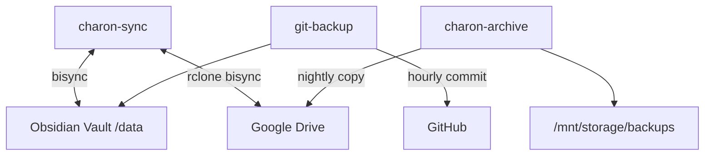

# Charon

The Ferryman — storage, sync, and persistence for the Yggdrasil ecosystem. Three services ferry data between Gaia's vault and the cloud.



## Services

| Service | Role | Schedule |
|---------|------|----------|
| charon-sync | Bi-directional vault sync with Google Drive via rclone bisync | Every 5min |
| charon-archive | Nightly backup of infrastructure dumps to Google Drive | 3am NZT |
| git-backup | Hourly git commits of vault to private GitHub repo | Hourly |

## Networks

- `aether-net` — external overlay for Google Drive API access
- `internal` — stack-internal overlay

## Failure Notifications & Monitoring

Charon integrates with Discord for instant error alerting:
- **Discord Webhook**: Configured via `DISCORD_ALERTS_WEBHOOK_URL` (GitHub secret or environment).
- **Thread & User Auto-Add**:
  - In **Forum Channels**, alerts automatically spawn a new thread (`🚨 Charon Alert: <Title>`).
  - Set `DISCORD_USER_ID` (GitHub secret or var) to automatically mention and add your user to the thread.
  - In standard text channels, alerts fall back gracefully to inline messages.
- **Triggers**:
  - `charon-sync`: Critical bisync errors, cache corruption / forced resync.
  - `charon-archive`: Failures in nightly `rclone copy` (3am) or retention prune `rclone delete` (4am).
  - `git-backup`: Unresolved git rebase divergence or remote push failures.
- **Healthchecks**: Real-time heartbeat validation across all three services to detect stuck sync loops or frozen network operations.
- **Resource Limits**: CPU (0.50) and memory limits (512M) enforced across all containers.

## Quick Deploy

Host directories and permissions are managed centrally by [`yggdrasil-os`](https://github.com/yggdrasil-lab/yggdrasil-os).

```bash
curl -fsSL https://raw.githubusercontent.com/yggdrasil-lab/yggdrasil-os/main/deploy/deploy.sh -o /tmp/deploy.sh && chmod +x /tmp/deploy.sh
/tmp/deploy.sh "charon" docker-compose.yml
```

## Google Drive Configuration (Dedicated Client ID)

Charon relies on an rclone config mounted from Docker secret `charon_rclone_config` (populated from GitHub Secret `RCLONE_CONFIG` during deployment).

To avoid Google Drive API query throttling (`googleapi: Error 403: Quota exceeded ... RATE_LIMIT_EXCEEDED`) and bisync abort cascades, use a dedicated Google Cloud OAuth Client ID and secret rather than rclone's default shared credentials.

See [`rclone/rclone.conf.example`](rclone/rclone.conf.example) for reference:

```ini
[gdrive]
type = drive
client_id = <your-client-id>.apps.googleusercontent.com
client_secret = <your-client-secret>
scope = drive
token = {"access_token":"...","token_type":"Bearer","refresh_token":"...","expiry":"..."}
```

Updating the GitHub Secret `RCLONE_CONFIG` and deploying automatically creates a new hashed Swarm secret (`ensure_secret.sh`) and rotates the containers seamlessly.

## Full Documentation

Operational details, environment variables, secrets, backup architecture, pitfalls, and historical context live in the vault at `Areas/90-Infrastructure/Charon/Charon Stack.md`.
